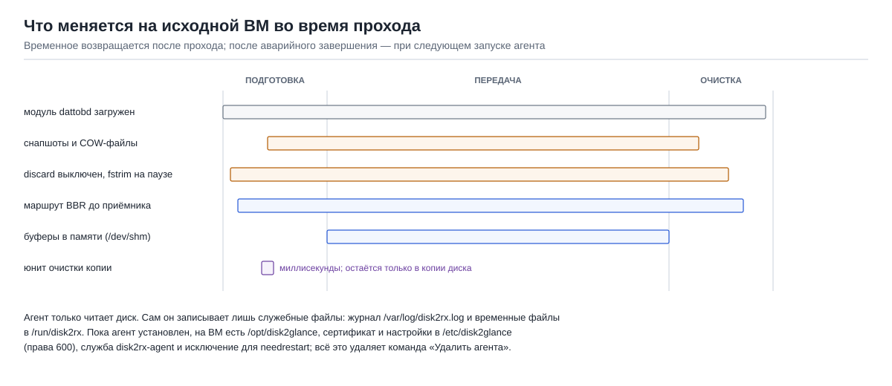
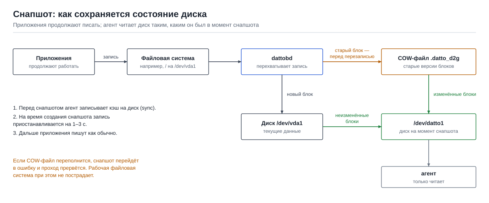
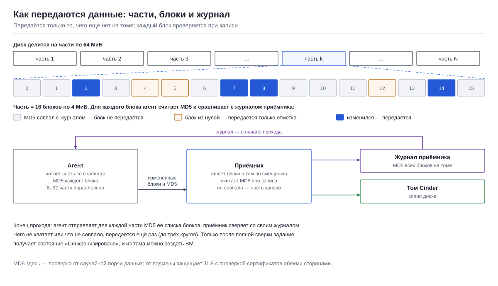
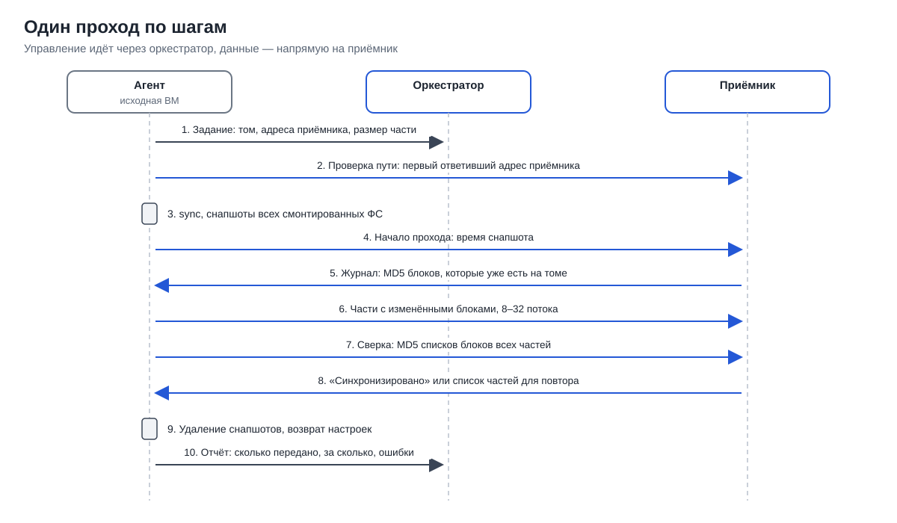

# Как работает агент и насколько это безопасно

Документ для инженеров и специалистов по безопасности, которые решают, можно ли ставить агент на
рабочую ВМ. Здесь описано, что агент делает с исходной ВМ, как он читает и передаёт данные, как
проверяется копия, что происходит при сбоях и какие права у агента есть. Описан агент `disk2rx`
для переноса через оркестратор; агенты для Glance и S3 используют тот же механизм снапшотов.
Термины — в [README](../README.md#термины), оглавление документации — в [docs/README.md](README.md).

## Содержание

- [Коротко](#коротко)
- [Что меняется на исходной ВМ](#что-меняется-на-исходной-вм)
- [Снапшот](#снапшот)
- [Передача данных: части, блоки и журнал](#передача-данных-части-блоки-и-журнал)
- [Один проход по шагам](#один-проход-по-шагам)
- [Как проверяется копия](#как-проверяется-копия)
- [Что будет при сбое](#что-будет-при-сбое)
- [Права и доступ](#права-и-доступ)
- [Нагрузка на исходную ВМ](#нагрузка-на-исходную-вм)
- [Что нужно учитывать](#что-нужно-учитывать)

## Коротко

- **Агент только читает диск.** Данные на исходной ВМ он не изменяет. Временные изменения в
  системе (снапшот, отключённый discard, маршрут до приёмника) снимаются после каждого прохода.
- **Приложения не останавливаются.** При создании снапшота запись на диск приостанавливается на
  1–3 секунды, на сильно нагруженных медленных дисках — дольше.
- **У агента нет доступа к облаку.** Его сертификат позволяет только записывать данные в свой
  том через приёмник. Учётная запись облака хранится только на оркестраторе.
- **Оркестратор не может выполнять на исходной ВМ произвольные команды.** Агент понимает
  ровно две команды: «выполнить проход» и «удалить себя».
- **Копия проверяется.** Каждый блок сверяется по MD5 при записи на том, в конце прохода
  сверяются все части. Создать ВМ можно только из полностью сверенной копии.
- **Сбой не затрагивает рабочую систему.** Обрыв связи, остановка агента или переполнение
  снапшота прерывают только проход; его можно повторить, уже переданное не передаётся заново.

## Что меняется на исходной ВМ

| Что | Когда | Как возвращается |
|---|---|---|
| Модуль ядра dattobd | загружается на время прохода | выгружается после прохода, если его загрузил агент |
| Снапшоты и COW-файлы `.datto_d2g` в корне каждой файловой системы | на время прохода | удаляются после прохода |
| Опция `discard` у файловых систем, таймер `fstrim.timer` | на время существования снапшотов | восстанавливаются после удаления снапшотов |
| Маршрут до адреса приёмника с алгоритмом TCP BBR | на время прохода | удаляется после прохода; остальной трафик ВМ не меняется |
| Буферы частей в памяти (`/dev/shm/disk2rx`) | во время передачи | удаляются после прохода |
| Юнит `disk2glance-cowclean.service` | несколько миллисекунд при создании снапшота | удаляется сразу; остаётся только в копии диска, где на первой загрузке новой ВМ удаляет COW-файлы и выключает агент |
| Программы агента `/opt/disk2glance`, настройки и сертификат `/etc/disk2glance` (права 600), служба `disk2rx-agent`, исключение для `needrestart` | пока агент установлен | удаляются командой «Удалить агента» |

Если агент был завершён аварийно (например, `kill -9`), при следующем запуске он сам удалит
оставшиеся снапшоты и юнит и снова включит `fstrim.timer`. Перезагрузка ВМ возвращает всё
временное сама: снапшоты, маршрут и опции монтирования не сохраняются после перезагрузки, а
оставшийся COW-файл агент удалит перед следующим снапшотом.

## Снапшот

Снапшот делает модуль ядра [dattobd](https://github.com/datto/dattobd) (открытый исходный код,
используется в системах резервного копирования):

1. Агент выполняет `sync`, чтобы записать на диск изменения из кэша.
2. Для каждой смонтированной файловой системы ext3, ext4 или xfs создаётся снапшот. Ядро на
   мгновение замораживает ФС, dattobd создаёт в её корне COW-файл (по умолчанию 10 % размера
   ФС) и начинает перехватывать запись. Запись приложений в это время ждёт: обычно 1–3 секунды.
3. Дальше приложения пишут как обычно. Перед первой перезаписью каждого блока dattobd копирует
   его старое содержимое в COW-файл. Устройство `/dev/dattoN` всегда отдаёт состояние ФС на
   момент снапшота: неизменённые блоки — с диска, изменённые — из COW-файла.
4. Агент читает только `/dev/dattoN` и участки диска вне файловых систем.

Если за время прохода изменится больше данных, чем помещается в COW-файл, снапшот перейдёт в
состояние ошибки. Рабочая файловая система при этом не пострадает, проход завершится ошибкой, и
его можно повторить в часы меньшей нагрузки или с бо́льшим COW-файлом (`--cow-mb`).

Копия получается такой же, как диск после внезапного отключения питания в момент снапшота.
Журналируемые файловые системы и СУБД с журналом (PostgreSQL, MySQL InnoDB) восстанавливаются
при первой загрузке сами. Подробности о снапшотах, LVM и паузе записи — в
[how-it-works.md](how-it-works.md).

## Передача данных: части, блоки и журнал

Диск делится на **части** по 64 МиБ, каждая часть — на 16 **блоков** по 4 МиБ. Приёмник ведёт
**журнал**: для каждой части — MD5 всех её блоков, уже записанных на том.

Как агент обрабатывает одну часть:

1. Читает часть со снапшота в буфер в памяти.
2. Считает MD5 каждого из 16 блоков.
3. Сравнивает с журналом, полученным от приёмника в начале прохода:
   - MD5 совпал — блок уже есть на томе, он не передаётся;
   - блок состоит из нулей — передаётся только отметка о нём, без данных;
   - блок отличается — передаётся.
4. Отправляет изменённые блоки одним запросом вместе со списком их номеров и MD5.

Приёмник записывает каждый блок в том по его смещению и одновременно считает MD5 полученных
данных. Если MD5 совпал с присланным, журнал обновляется. Если нет, приёмник удаляет часть из
журнала и отвечает ошибкой, и агент передаёт часть заново целиком.

Агент обрабатывает 8–32 части параллельно (настраивается). Из этого же следуют дельты: на
втором и следующих проходах журнал уже заполнен, и передаются только блоки, изменившиеся с
прошлого прохода. COW-файлы снапшота агент передаёт как нули: их содержимое на новой ВМ не нужно
(там они удаляются при первой загрузке), и они не занимают канал.

## Один проход по шагам

Управляющие запросы (задание, отчёт) идут к оркестратору, данные — напрямую на приёмник. Все
соединения — HTTPS с проверкой сертификатов обеими сторонами (mTLS). Подробное описание
запросов — в [receiver-mode.md](receiver-mode.md).

## Как проверяется копия

| Что проверяется | Кем и когда | Что при несовпадении |
|---|---|---|
| Размер диска совпадает с размером тома задания | агент, в начале прохода | проход не начинается |
| MD5 каждого записанного блока | приёмник, при записи | часть удаляется из журнала и передаётся заново |
| Длина и номера блоков в запросе | приёмник | запрос отклоняется |
| Все части диска есть на томе и совпадают | агент и приёмник, в конце прохода: агент присылает MD5 списка блоков каждой части, приёмник сверяет со своим журналом | недостающие части передаются ещё раз, до трёх кругов |
| Задание готово к созданию ВМ | оркестратор | «Создать ВМ» доступно только в состоянии «Синхронизировано» |

MD5 здесь защищает от случайной порчи данных при передаче и записи. От подмены данных защищает
TLS: соединение с приёмником возможно только с сертификатом агента, выпущенным оркестратором.

Итоговая сверка опирается на журнал приёмника, а не на повторное чтение всего тома. Для
окончательной проверки на тестовом переносе можно сравнить данные на новой ВМ с исходной
(например, скриптом `verify-clone.sh` из репозитория).

## Что будет при сбое

| Ситуация | Рабочая система | Копия | Что делать |
|---|---|---|---|
| Обрыв связи, приёмник недоступен | не затронута | часть повторяется до 12 раз с паузой до 60 с, затем ещё до трёх кругов; если не помогло — проход завершается ошибкой | повторить проход; уже переданные блоки не передаются заново |
| Приёмник перегружен | не затронута | приёмник отвечает «занят», агент повторяет через секунду | ничего, это штатная ситуация |
| Агент остановлен (`systemctl stop`, Ctrl+C) | снапшоты удаляются, настройки возвращаются | проход не завершён, копия не «Синхронизировано» | повторить проход |
| Агент завершён аварийно (`kill -9`) | снапшот остаётся до следующего запуска агента | проход не завершён | при следующем запуске агент уберёт остатки сам |
| Перезагрузка исходной ВМ во время прохода | временные изменения пропадают при перезагрузке; оставшийся COW-файл агент удалит при следующем проходе | проход не завершён | после загрузки повторить проход |
| Переполнение COW-файла | не затронута | проход завершается ошибкой | повторить при меньшей нагрузке или с `--cow-mb` |
| Ошибка MD5 при записи блока | не затронута | часть передаётся заново | ничего |
| Обновление пакетов во время прохода | не затронута | агент исключён из автоматических перезапусков `needrestart` | ничего |
| Размер диска изменился после регистрации | не затронута | проход не начинается | создать новое задание |
| Попытка второго запуска одновременно | не затронута | второй запуск отказывается работать | ничего |

Во всех случаях задание остаётся в состоянии, отличном от «Синхронизировано», пока очередной
проход не завершится полной сверкой, поэтому ВМ из недописанной копии случайно не создать.

## Права и доступ

| | |
|---|---|
| Права на исходной ВМ | root: нужен для загрузки модуля ядра, создания снапшотов и чтения блочного устройства |
| Что агент получает при установке | одноразовый токен (действует 60 минут, один раз) и отпечаток ключа оркестратора; скрипт установки скачивается только после проверки этого отпечатка |
| Ключ агента | создаётся на исходной ВМ и её не покидает; оркестратор подписывает только запрос на сертификат |
| Что разрешает сертификат агента | получить своё задание и команды, отправить отчёт, записать данные в том своего задания |
| Чего агент не может | обращаться к API облака, читать или писать чужие тома, получать данные с приёмника кроме журнала своего задания |
| Команды от оркестратора | только «выполнить проход» и «удалить агента»; любые другие команды агент отклоняет |
| Отзыв доступа | «Отключить» в интерфейсе (`d2g agent revoke`): сертификат перестаёт приниматься оркестратором и приёмниками в течение 5 секунд |
| Копия диска | новая ВМ содержит копию агента, но не может выдать себя за исходную: на первой загрузке служебный юнит удаляет идентичность агента, а сам агент сверяет UUID ВМ и выключается на копии |
| Сетевые соединения | только исходящие: HTTPS 443 к оркестратору и приёмнику; входящие порты на исходной ВМ не нужны |

Подробнее о сертификатах и защите веб-интерфейса — в
[orchestrator.md](orchestrator.md#безопасность).

## Нагрузка на исходную ВМ

| Ресурс | Что происходит | Как ограничить |
|---|---|---|
| Запись на диск | пауза 1–3 с при создании снапшота; затем первая запись в каждый блок требует дополнительного чтения и записи в COW-файл | переносить в часы меньшей нагрузки |
| Чтение диска | каждый проход читает весь диск (и первый, и дельты) | меньше потоков агента |
| Процессор | MD5 блоков и шифрование TLS; на 2 vCPU агент может занимать процессор заметно | меньше потоков агента |
| Память | буферы: размер части × число потоков (64 МиБ × 8 = 512 МиБ) в `/dev/shm` | меньше потоков |
| Сеть | исходящий трафик к приёмнику | меньше потоков или расписание дельт на ночь |

Число потоков задаётся при добавлении ВМ в интерфейсе или командой
`d2g agent add ИМЯ --threads N`. Замеры влияния на приложения — в
[speed-tests.md](speed-tests.md#3-диск-источника).

## Что нужно учитывать

- **Участки вне файловых систем читаются без снапшота:** таблица разделов, загрузочные разделы
  BIOS и EFI, swap, несмонтированные разделы. Они почти не меняются во время работы, но не
  следует обновлять загрузчик во время прохода.
- **Копия согласована на уровне диска, а не приложения.** Для приложений без журнала
  остановите запись перед последним проходом.
- **Операции с томами LVM во время прохода** (`lvcreate`, `lvextend`, `pvmove`) не допускаются.
- **MD5 — не цифровая подпись.** Он защищает от случайной порчи; от подмены защищает TLS.
- Полный список ограничений — в [limitations.md](limitations.md).
