# Перенос через оркестратор: пошаговое руководство

Это руководство для инженера, который запускает перенос впервые. Мы создадим в VK Cloud
виртуальную машину-оркестратор, установим на неё d2g, подключим исходные ВМ и перенесём их
диски. Опыт работы с OpenStack не нужен: достаточно уметь подключаться по SSH и копировать
команды.

Время: около 30 минут на подготовку, дальше — минуты на каждую ВМ (см.
[speed-tests.md](speed-tests.md)).

## Содержание

- [Как это работает](#как-это-работает)
- [Что понадобится](#что-понадобится)
- [Шаг 1. Подготовить проект в VK Cloud](#шаг-1-подготовить-проект-в-vk-cloud)
- [Шаг 2. Подключиться к ВМ по SSH](#шаг-2-подключиться-к-вм-по-ssh)
- [Шаг 3. Установить d2g](#шаг-3-установить-d2g)
- [Шаг 4. Открыть веб-интерфейс через SSH-туннель](#шаг-4-открыть-веб-интерфейс-через-ssh-туннель)
- [Шаг 5. Пройти мастер настройки](#шаг-5-пройти-мастер-настройки)
- [Шаг 6. Войти в интерфейс](#шаг-6-войти-в-интерфейс)
- [Шаг 7. Подключить исходные ВМ (установить агентов)](#шаг-7-подключить-исходные-вм-установить-агентов)
- [Шаг 8. Запустить перенос](#шаг-8-запустить-перенос)
- [Шаг 9. Создать новую ВМ](#шаг-9-создать-новую-вм)
- [Шаг 10. Удалить агента с исходной ВМ](#шаг-10-удалить-агента-с-исходной-вм)
- [Перенос в другой проект](#перенос-в-другой-проект)
- [Если что-то пошло не так](#если-что-то-пошло-не-так)
- [Что дальше](#что-дальше)

## Как это работает


1. На каждой исходной ВМ работает небольшой **агент**. Он делает снимок (снапшот) диска, не
   останавливая приложения, и отправляет только занятые блоки.
2. **Оркестратор** — это ВМ в VK Cloud, которой вы управляете через браузер. Для каждой
   исходной ВМ он создаёт **том** (облачный диск) того же размера, и **приёмник** на оркестраторе
   записывает в этот том полученные данные.
3. Перенос можно повторять: каждый следующий проход (**дельта**) передаёт только то, что
   изменилось на исходной ВМ. Так копия догоняет оригинал.
4. Когда всё готово к переключению, вы нажимаете **«Создать ВМ»**: том отключается от
   приёмника и становится диском новой ВМ. Новая ВМ — точная копия исходной на момент
   последнего снапшота.
5. Если ВМ нужна в **другом проекте** VK Cloud, том можно передать туда (проект в том же
   регионе) или принимать диск сразу в том проекте (любой регион) — см. раздел
   «Перенос в другой проект».

Учётная запись облака хранится только на оркестраторе. На исходные ВМ попадает лишь
сертификат агента, который позволяет записывать данные только в свой том. Что именно агент
делает на исходной ВМ и почему это безопасно — в [agent.md](agent.md).


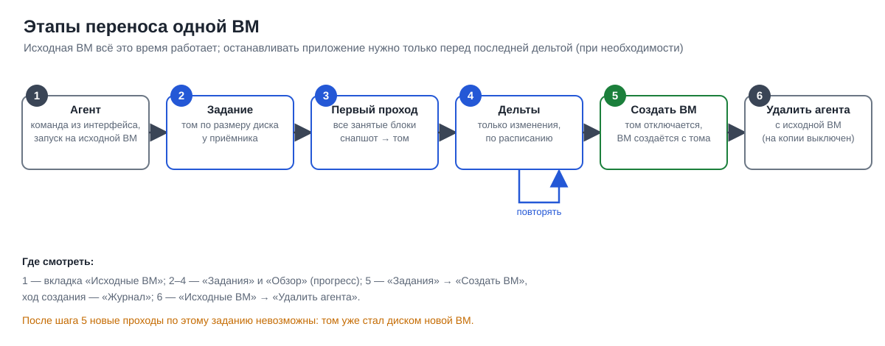

## Что понадобится

- Доступ в личный кабинет VK Cloud к проекту, **куда** переносятся ВМ.
- **Сервисная учётная запись** этого проекта с ролью «Администратор виртуальных машин»
  (`mcs_admin_vm`). Как её создать — в шаге 1.
- SSH-ключ (пара: закрытый ключ у вас, открытый — в VK Cloud).
- Список исходных ВМ: адреса, с которых они будут подключаться к оркестратору (внутренние
  подсети или внешние адреса).
- На исходных ВМ: Linux, доступ root, исходящий HTTPS (порт 443) до оркестратора. Интернет
  исходным ВМ не нужен: если они связаны с проектом через Direct Connect или VPN, передача пойдёт
  по этой сети (см. [network.md](network.md)).


---

## Шаг 1. Подготовить проект в VK Cloud

**1.1. Выберите регион и проект.** В личном кабинете VK Cloud переключитесь на нужный
регион (например, Москва или Казахстан — для Казахстана используется свой кабинет) и на
проект, в котором должны появиться перенесённые ВМ.

**1.2. Создайте сервисную учётную запись.** Раздел «Управление доступом» (IAM) → «Сервисные
учётные записи» → «Создать»:

- имя — например, `migration`;
- роль — «Администратор виртуальных машин»;
- задайте пароль и сохраните его: он понадобится в мастере настройки.

Полное имя пользователя будет вида `svc-<ID проекта>-migration`, домен — `service-users`. ID
проекта и адрес Keystone видны на странице «Доступ по API» проекта. Подробнее о ролях — в
[service-accounts.md](service-accounts.md).

**1.3. Загрузите открытый SSH-ключ.** «Облачные вычисления» → «Ключевые пары» → «Импортировать
ключ» (или создайте новый и скачайте закрытый ключ).

**1.4. Создайте ВМ оркестратора.** «Облачные вычисления» → «Виртуальные машины» → «Создать».
Названия пунктов в кабинете могут немного отличаться.

| Параметр | Значение |
|---|---|
| Имя | `d2g-ctl` |
| Образ | Ubuntu 24.04 |
| Тип ВМ | 4–8 vCPU, 8 ГБ памяти (например, `STD3-4-8`) |
| Диск | 20 ГБ, тип `ceph-ssd` |
| Сеть | сеть проекта, в которой будут новые ВМ (у неё должен быть маршрутизатор с выходом в интернет) |
| Группы безопасности | `default` и группа с открытым портом 22 (SSH) |
| Ключ | ключ из шага 1.3 |
| Внешний IP (FIP) | назначить — по нему вы подключитесь к ВМ, а исходные ВМ из интернета — к оркестратору |

Порт 443 открывать вручную не нужно: мастер настройки сделает это сам и только для нужных
адресов.

> **Для ускорения (необязательно).** Если оркестратор будет принимать много ВМ, включите
> multiqueue — несколько очередей сетевой карты. Это делается до создания ВМ командой
> `openstack volume set --image-property hw_vif_multiqueue_enabled=true <загрузочный том>`
> (подробнее в [speed-tests.md](speed-tests.md#2-мощность-вм-источника-и-приёмника)).

## Шаг 2. Подключиться к ВМ по SSH

На своём компьютере (macOS, Linux или Windows 10/11 — в PowerShell команда `ssh` уже есть):

```bash
chmod 600 ~/.ssh/<ключ>            # только macOS и Linux: SSH требует, чтобы ключ был доступен только вам
ssh -i ~/.ssh/<ключ> ubuntu@<FIP оркестратора>
```

При первом подключении SSH спросит, доверять ли серверу: ответьте `yes`. Пользователь в
образах Ubuntu VK Cloud — `ubuntu`, команды администратора выполняются через `sudo`.

Если у оркестратора нет FIP и подключаться нужно через джамп-хост (бастион), команды для
этого случая — в [ssh.md](ssh.md#подключение-через-джамп-хост).

## Шаг 3. Установить d2g

На ВМ оркестратора выполните одну команду:

```bash
curl -fsSL https://github.com/jaland-hara/disk2glance/releases/latest/download/d2g-server-install.sh | sudo bash
```

Установщик скачает последнюю версию, проверит её контрольную сумму, установит nginx и
оркестратор и в конце выведет примерно такой текст:

```
  d2g orchestrator ctl.5ed4d7.d2g is waiting for its setup.
  Open    https://203.0.113.10/setup   (grey address: https://10.0.10.8/setup)
  Code    6476-a9c1-1226    (valid 1 hour, once; a new one: sudo d2g setup-code)
  Check the certificate in the browser: SHA-256 2F:F9:33:…:60:1E
```

Сохраните **код** (`Code`) и **отпечаток сертификата** (`SHA-256`). Код действует один час и
только один раз; новый код выдаёт команда `sudo d2g setup-code`.

## Шаг 4. Открыть веб-интерфейс через SSH-туннель

Самый простой и безопасный способ — не открывать порт 443 наружу, а подключиться через
SSH-туннель.

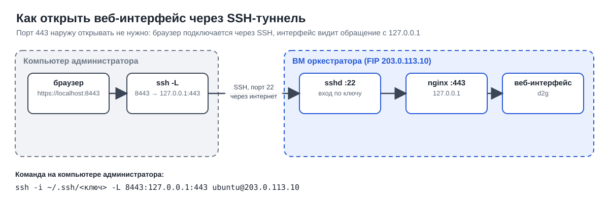

1. На своём компьютере откройте **новое** окно терминала и выполните:

   ```bash
   ssh -i ~/.ssh/<ключ> -L 8443:127.0.0.1:443 ubuntu@<FIP оркестратора>
   ```

   Пока это окно открыто, туннель работает. Если у оркестратора нет FIP, туннель строится
   через джамп-хост: `ssh -J ubuntu@<FIP джамп-хоста> -L 8443:127.0.0.1:443 ubuntu@<серый адрес
   оркестратора>` (подробнее — в [ssh.md](ssh.md#проброс-порта-веб-интерфейса)).
2. В браузере откройте `https://localhost:8443/setup`.
3. Браузер предупредит, что сертификат не подтверждён: сертификат самоподписанный, потому что
   у оркестратора нет домена. Откройте сведения о сертификате и сравните отпечаток SHA-256 с
   тем, который вывел установщик. Если совпадает — продолжайте («Дополнительно» →
   «Перейти на сайт»).

## Шаг 5. Пройти мастер настройки

**Код.** Введите код из шага 3.

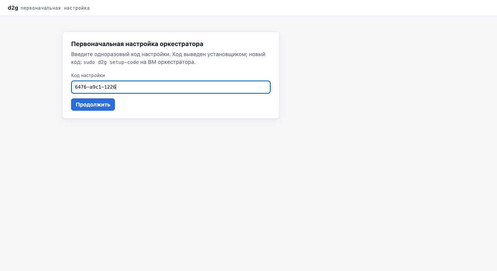

**1. Администратор.** Имя и пароль для входа в интерфейс (не короче 12 символов). Включите
второй фактор (TOTP): отсканируйте QR-код приложением (Google Authenticator, Яндекс Ключ и
т. п.) и введите код из него.

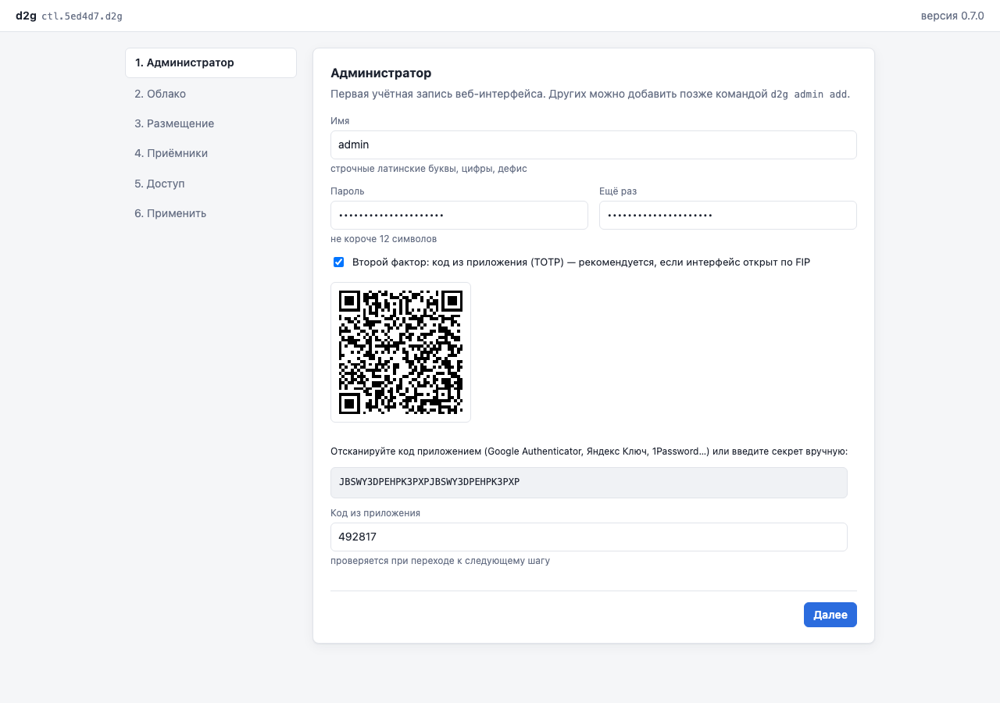

**2. Облако.** Данные сервисной учётной записи из шага 1.2: ID проекта, имя пользователя,
пароль. Адрес Keystone, регион и домен уже подставлены для московского региона VK Cloud; для
другого региона возьмите их на странице «Доступ по API». Нажмите «Проверить»: оркестратор
создаст и удалит пробный том и группу безопасности. Все строки должны быть с зелёной галочкой.

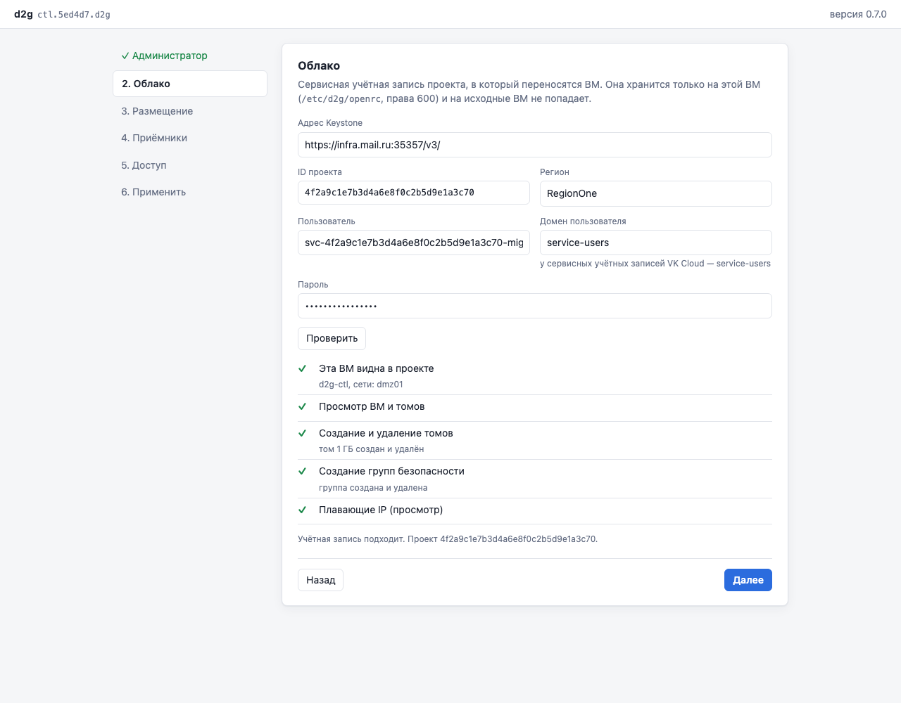

**3. Размещение.** Зона, сеть и публичный адрес определяются автоматически. Обычно ничего
менять не нужно.

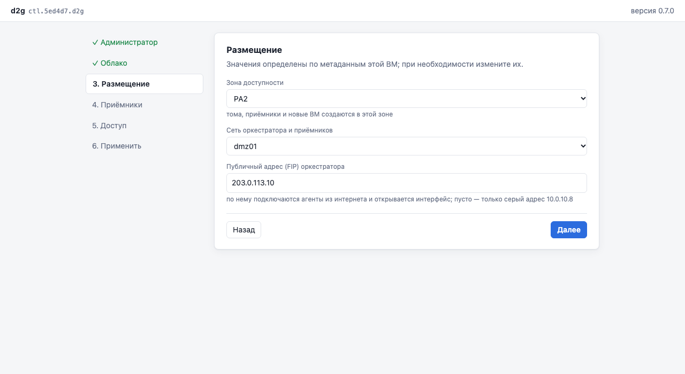

**4. Приёмники.** Оставьте «Приёмник на этой ВМ» включённым. Остальные параметры нужны,
только если оркестратору придётся создавать отдельные приёмники (когда на этой ВМ закончится
место для томов).

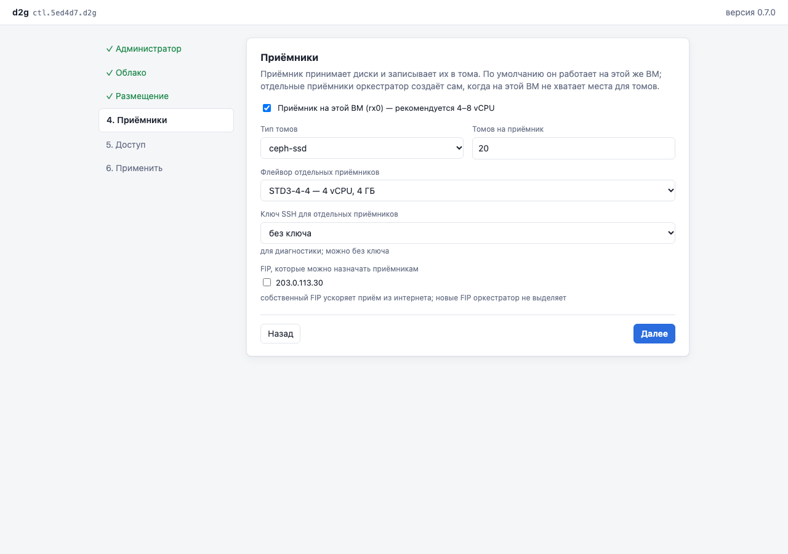

**5. Доступ.**

- «Веб-интерфейс открыт для» — оставьте как есть: при работе через туннель это `127.0.0.1/32`.
- «Исходные ВМ подключаются с» — адреса исходных ВМ, по одному в строке: подсеть (например,
  `10.0.10.0/24`) или внешний адрес, с которого ВМ выходит в интернет (`203.0.113.1/32`).
- Оставьте отмеченным «Открыть 443…»: мастер откроет порт 443 только для этих адресов.

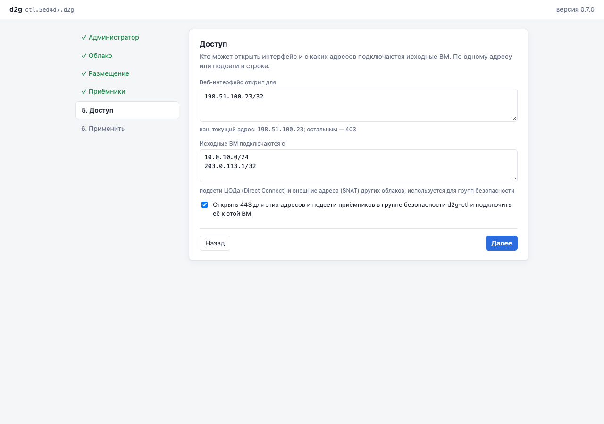

**6. Применить.** Проверьте сводку и нажмите «Применить». Через минуту появится список
выполненных действий.

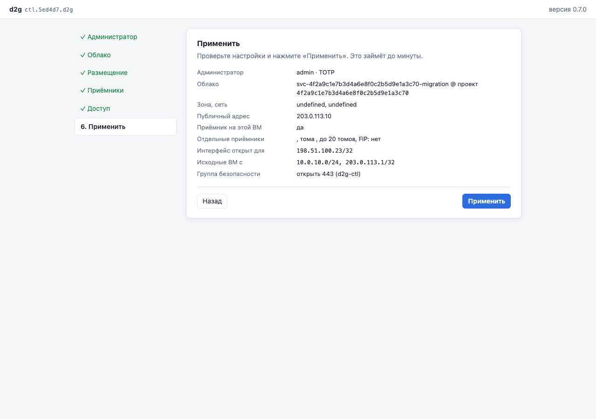
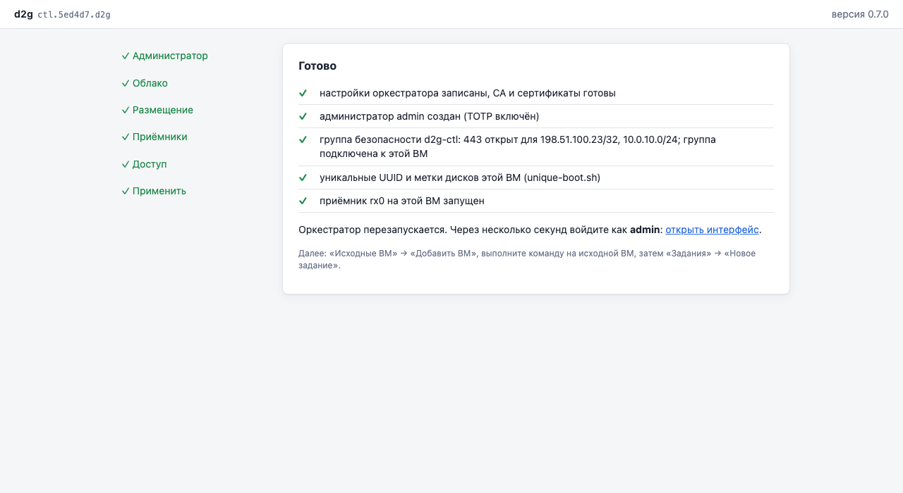

## Шаг 6. Войти в интерфейс

Откройте `https://localhost:8443/` (туннель из шага 4 должен быть открыт) и войдите под
администратором из мастера.

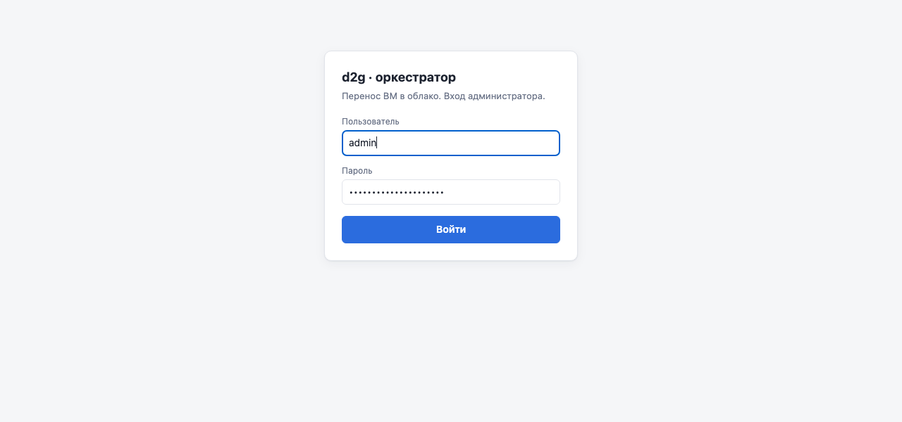

Вкладки интерфейса:

| Вкладка | Для чего |
|---|---|
| Обзор | сколько ВМ подключено, текущие переносы и их прогресс |
| Исходные ВМ | подключение агентов, их состояние |
| Задания | переносы: запуск, дельты, создание новой ВМ |
| Приёмники | где принимаются диски, сколько томов подключено |
| Проекты | другие проекты VK Cloud, куда можно переносить ВМ |
| Журнал | ход операций и история действий |
| Настройки | доступ, приёмники, учётная запись облака |

## Шаг 7. Подключить исходные ВМ (установить агентов)

1. «Исходные ВМ» → «Добавить ВМ». Укажите имя (латиницей, например `web01`), остальное
   оставьте по умолчанию и нажмите «Получить команду».

   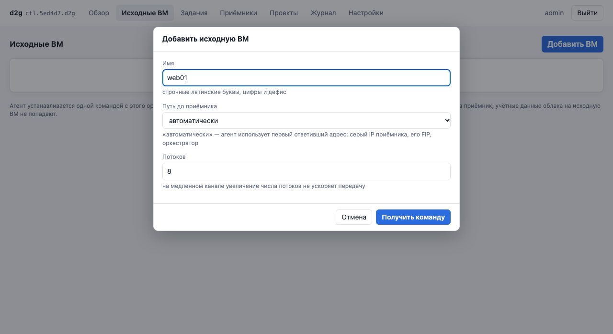

2. Интерфейс покажет две команды. Выберите ту, что подходит исходной ВМ:
   - **через интернет** — если ВМ в другом облаке или ЦОДе без прямой связи с VK Cloud;
   - **серый адрес** — если ВМ в той же сети VK Cloud или ЦОД подключён через Direct Connect.

   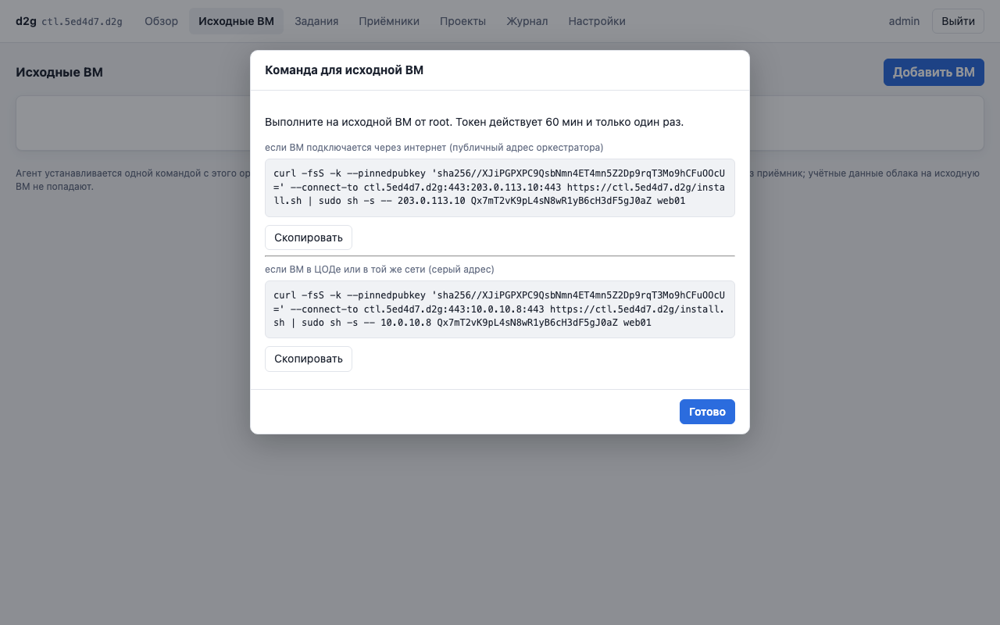

3. Подключитесь к **исходной** ВМ по SSH и выполните скопированную команду. Команда действует
   60 минут и только один раз. Установка занимает несколько секунд; в конце будет строка
   `disk2rx-agent.service started`.

4. В интерфейсе ВМ появится со статусом «Подключён», с ОС, ядром и размером диска.

   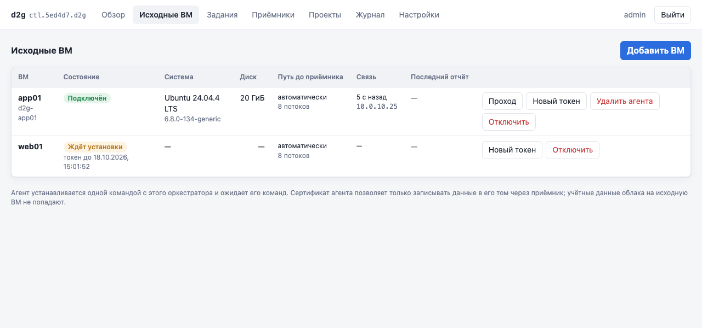

Повторите для каждой исходной ВМ. Если ВМ осталась в статусе «Ждёт установки», команда не
была выполнена или исходная ВМ не может подключиться к оркестратору (проверьте адреса в шаге
5 → «Доступ» и исходящий доступ к порту 443).

## Шаг 8. Запустить перенос

1. «Задания» → «Новое задание». Выберите исходную ВМ. «Куда переносить» — «этот проект», тип
   тома оставьте как есть. «Зона» — зона доступности, где должна работать новая ВМ: в ней
   будут том, приёмник и сама ВМ. Если в этой зоне ещё нет приёмника, оркестратор создаст его
   сам (около 1,5 минуты). Дельты по расписанию можно включить сразу (например, каждый час)
   или запускать вручную. Если у ВМ несколько дисков, в окне есть флажки «Диски»: по
   умолчанию переносятся все, загрузочный обязателен. Снапшоты всех дисков снимаются в одну
   точку времени, каждый диск переносится в свой том.

   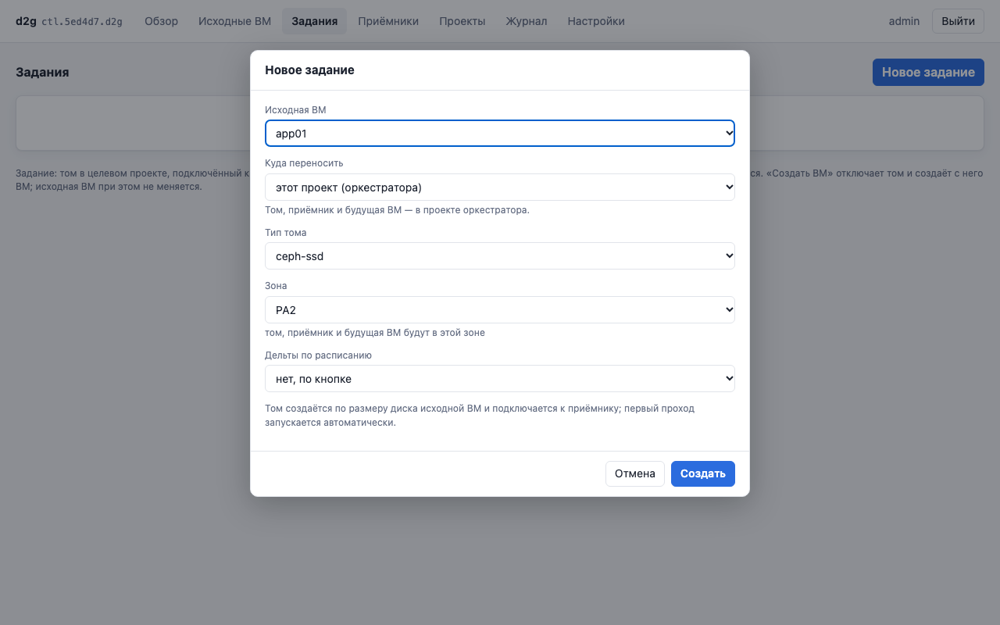

2. Оркестратор создаст по тому на каждый диск, подключит их к приёмнику, и первый проход
   начнётся сам. Ход
   виден на вкладках «Задания» и «Обзор».

   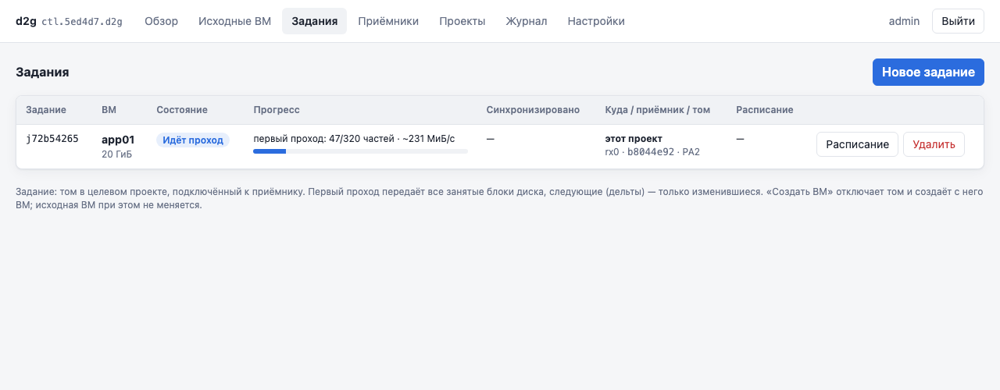
   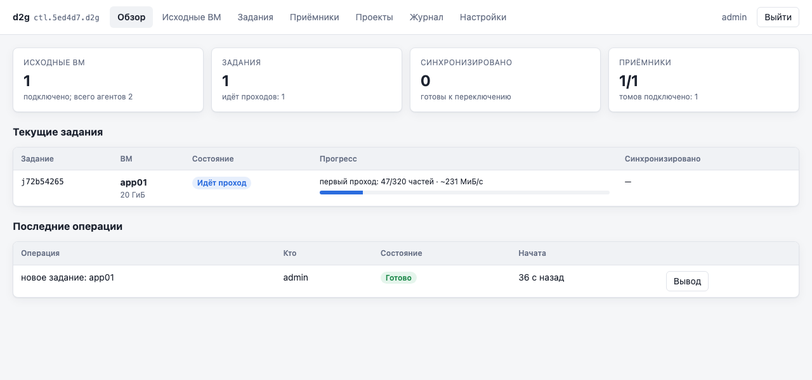

3. Когда первый проход закончится, задание перейдёт в состояние «Синхронизировано». Копия
   на томе соответствует исходной ВМ на момент снапшота.

   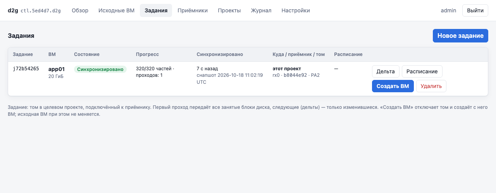

4. Пока исходная ВМ работает, данные на ней меняются. Кнопка «Дельта» передаёт только
   изменения и занимает несколько минут. Повторяйте её столько, сколько нужно.

## Шаг 9. Создать новую ВМ

1. Перед переключением остановите приложения на исходной ВМ (если важно, чтобы ни одна
   запись не потерялась) и нажмите «Дельта» в последний раз.
2. Нажмите «Создать ВМ». Укажите имя, тип ВМ (не меньше исходной по vCPU и памяти), сеть,
   группы безопасности и SSH-ключ.

   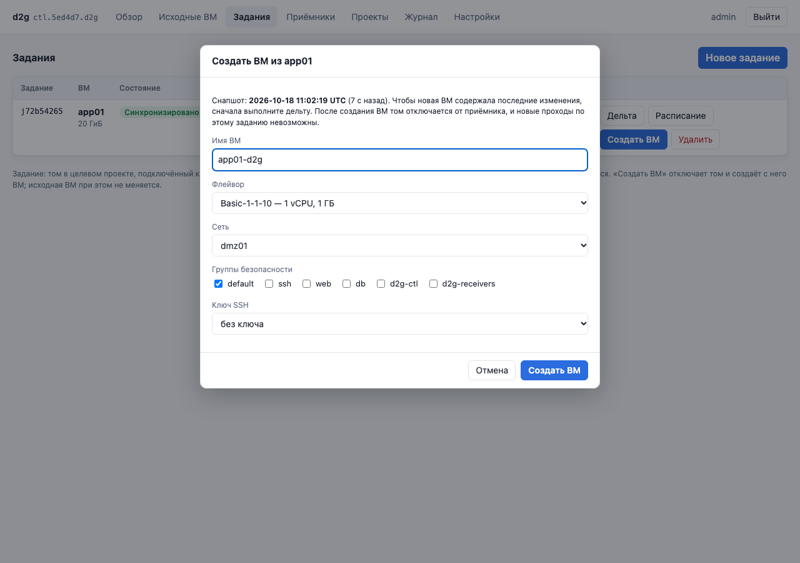

3. Что происходит с диском: том отключается от приёмника, становится загрузочным и
   подключается к новой ВМ как её диск. Копирования не происходит, поэтому ВМ создаётся
   меньше чем за минуту. Ход операции виден во вкладке «Журнал» (кнопка «Вывод»).

   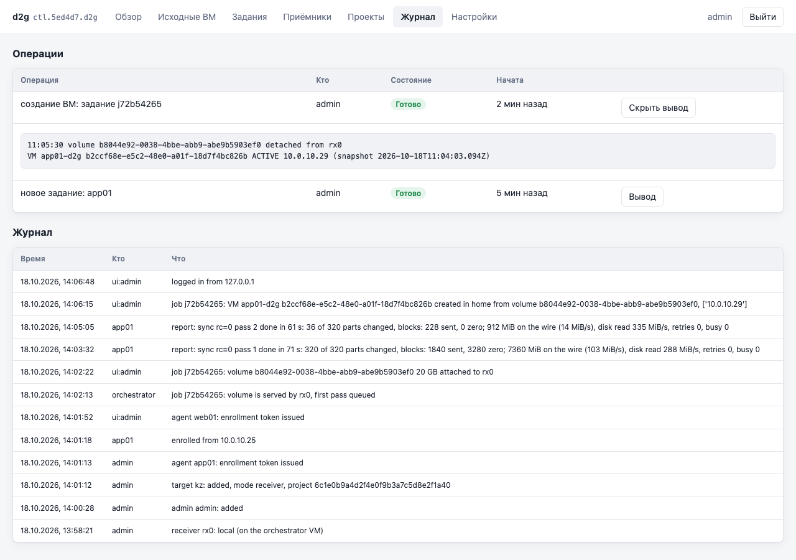

4. Задание перейдёт в состояние «ВМ создана». Новые проходы по нему уже невозможны: том
   теперь принадлежит новой ВМ.

   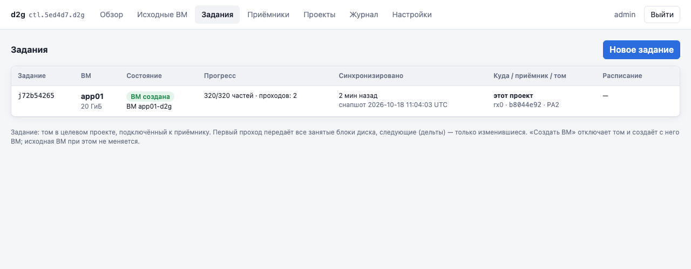

5. Проверьте новую ВМ: подключитесь по SSH, убедитесь, что запустились приложения и данные
   на месте. При первой загрузке файловые системы и базы данных восстанавливаются по своим
   журналам — как после внезапного отключения питания; на медленных дисках это может занять
   несколько минут.

На новой ВМ агент выключается сам: оркестратор не перепутает копию с оригиналом.

## Шаг 10. Удалить агента с исходной ВМ

После переключения: «Исходные ВМ» → «Удалить агента». Агент удалит себя с исходной ВМ при
следующем обращении к оркестратору. Сама исходная ВМ не меняется — её можно остановить или
удалить по вашему плану переключения.

## Перенос в другой проект

Один оркестратор может переносить ВМ в разные проекты VK Cloud. Для каждого проекта нужна его
сервисная учётная запись (как в шаге 1.2, но в том проекте).

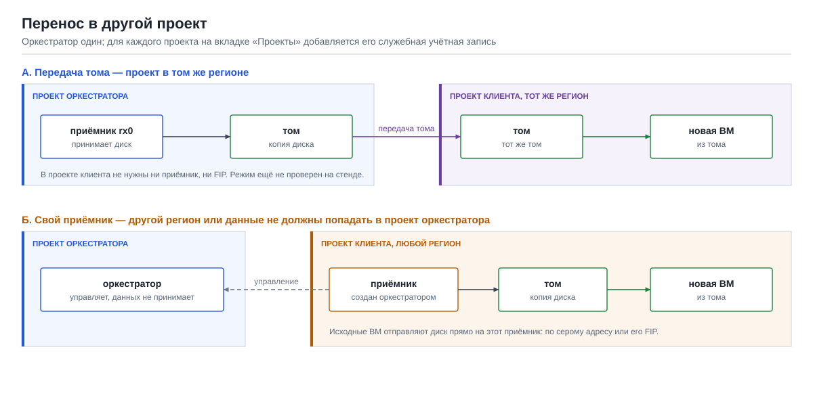

Есть два способа:

| | Передача тома | Свой приёмник |
|---|---|---|
| Когда | проект в **том же регионе** | **другой регион** или данные не должны попадать в проект оркестратора |
| Где принимается диск | в проекте оркестратора | сразу в целевом проекте, на приёмнике, который создаёт оркестратор |
| Что происходит при «Создать ВМ» | том передаётся в целевой проект (механизм передачи томов Cinder), и ВМ создаётся там | ВМ создаётся из тома в том же проекте |
| Что нужно в целевом проекте | только сервисная учётная запись | учётная запись и сеть; FIP для приёмника, если исходные ВМ подключаются через интернет |
| Состояние | реализовано, на стенде ещё не проверено | проверено (Москва → Казахстан) |

Как добавить проект:

1. «Проекты» → «Добавить проект». Укажите короткое имя (латиницей), название и способ.
2. Введите адрес Keystone, ID проекта, регион и данные сервисной учётной записи этого
   проекта, нажмите «Проверить учётную запись».
3. После проверки появятся настройки из этого проекта: зона, сеть, группы безопасности для
   новых ВМ; для своего приёмника — тип ВМ приёмника, тип томов, ключ, FIP. Нажмите
   «Сохранить».

   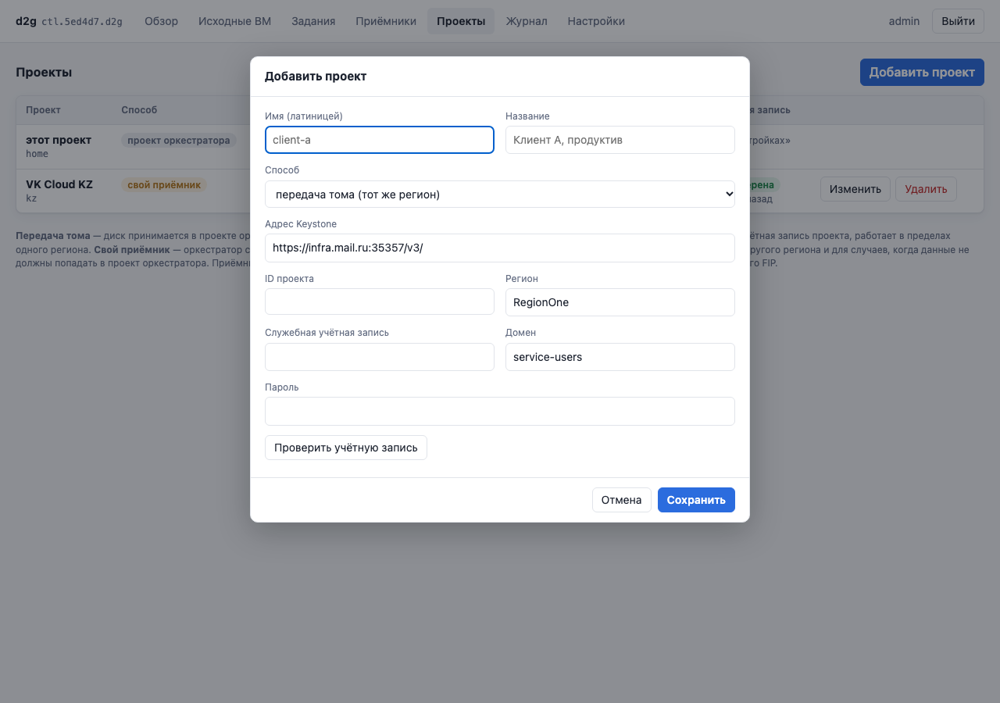
   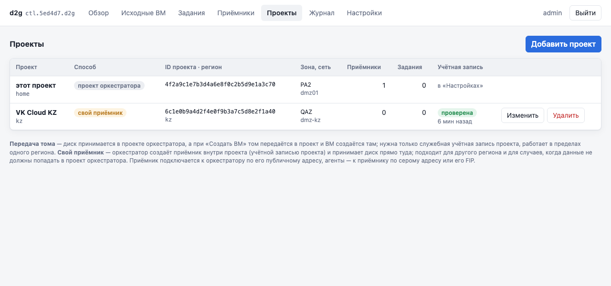

4. В «Новом задании» выберите этот проект в поле «Куда переносить». Дальше всё как в шагах
   8–9: форма «Создать ВМ» покажет типы ВМ, сети и группы безопасности целевого проекта.

## Если что-то пошло не так

| Что видно | Что сделать |
|---|---|
| Браузер не открывает `https://localhost:8443` | проверьте, что окно с туннелем (шаг 4) открыто и в нём нет ошибок |
| Не подключается по SSH, ошибки туннеля, `403 forbidden` | см. таблицу ошибок в [ssh.md](ssh.md#если-не-подключается) |
| Мастер: «неверный или истёкший код» | получите новый код: `sudo d2g setup-code` на ВМ оркестратора |
| Мастер: проверка облака с красными строками | у учётной записи нет роли «Администратор виртуальных машин» или неверен пароль/ID проекта |
| Исходная ВМ «Ждёт установки» | команда не выполнена или истекла (получите «Новый токен»); исходная ВМ не может подключиться к порту 443 оркестратора |
| Команда установки агента: `Connection timed out` | адрес исходной ВМ не добавлен в «Доступ» (вкладка «Настройки» → «Изменить доступ») или исходящий 443 закрыт на её стороне |
| Задание долго в «Идёт проход» | смотрите скорость на вкладке «Задания»; медленный диск или канал на стороне исходной ВМ — см. [speed-tests.md](speed-tests.md) |
| Новая ВМ не загружается | ВМ переносилась с VMware/Hyper-V: подготовьте драйверы по [guest-drivers.md](guest-drivers.md) и перенесите заново |

## Что дальше

- Справочник по оркестратору и командной строке `d2g` — [orchestrator.md](orchestrator.md).
- Скорость переноса и как её увеличить — [speed-tests.md](speed-tests.md).
- Подключение через джамп-хост и проброс портов — [ssh.md](ssh.md).
- Права сервисных учётных записей — [service-accounts.md](service-accounts.md).
