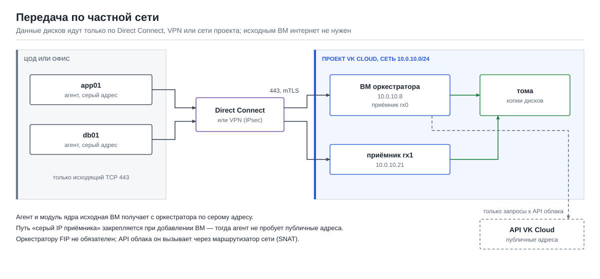

# Передача данных по частным сетям, без интернета

Данные исходных ВМ можно передавать в VK Cloud только по частной (серой) сети: внутри облака,
через Direct Connect или VPN между ЦОДом и облаком. Интернет для передачи дисков при этом не
нужен, а исходным ВМ не нужен даже выход в интернет. Здесь описано, как это устроено и что
настроить. Термины — в [README](../README.md#термины), оглавление документации — в
[docs/README.md](README.md).

## Содержание

- [Коротко](#коротко)
- [Как это выглядит](#как-это-выглядит)
- [Что нужно от сети](#что-нужно-от-сети)
- [Как настроить](#как-настроить)
- [Какие пути выбирает агент](#какие-пути-выбирает-агент)
- [Что всё-таки обращается в интернет](#что-всё-таки-обращается-в-интернет)
- [Перенос в другой проект по частной сети](#перенос-в-другой-проект-по-частной-сети)

## Коротко

- Агент отправляет данные напрямую на **серый адрес** приёмника или оркестратора. Если между
  исходной ВМ и сетью проекта VK Cloud есть маршрут, передача идёт только по нему.
- Исходной ВМ нужен **только исходящий TCP 443** до серых адресов оркестратора и приёмников.
  Агент и модуль ядра она получает с оркестратора, а не из интернета.
- Путь можно **закрепить** за агентом: тогда он не будет пробовать публичные адреса.
- Если у оркестратора **нет FIP**, публичных путей нет вообще.
- Шифрование не зависит от сети: передача всегда идёт по TLS с проверкой сертификатов обеими
  сторонами. Если нужна передача по ГОСТ, используйте сертифицированный ГОСТ-VPN как частный
  канал (почему не шифруем ГОСТ в самом продукте — в [gost.md](gost.md)).


## Как это выглядит



Варианты частной связности между исходными ВМ и проектом VK Cloud:

| Где исходные ВМ | Как связаны с проектом | Что использовать |
|---|---|---|
| В той же сети проекта VK Cloud | напрямую | серые адреса сети проекта |
| В другом проекте или регионе VK Cloud | связность сетей облака или VPN между проектами | серые адреса; для другого региона — свой приёмник в целевом проекте, см. ниже |
| В ЦОДе или офисе | Direct Connect (выделенный канал) или VPN (IPsec) | серые адреса проекта, доступные через этот канал |
| В другом облаке | VPN между облаками | серые адреса через VPN |

## Что нужно от сети

| Откуда | Куда | Порт | Зачем |
|---|---|---|---|
| исходные ВМ | серый адрес оркестратора | TCP 443 | установка агента, задания и команды, отчёты; данные, если приёмник — `rx0` на ВМ оркестратора |
| исходные ВМ | серые адреса отдельных приёмников | TCP 443 | данные |
| администратор | ВМ оркестратора | TCP 22 (или 443) | веб-интерфейс через SSH-туннель или напрямую |

Входящие порты на исходных ВМ не нужны. Порт 443 на оркестраторе и приёмниках открывается
группами безопасности `d2g-ctl` и `d2g-receivers` только для адресов, указанных в мастере
настройки в поле «Исходные ВМ подключаются с» (например, подсети ЦОДа `10.50.0.0/16`).

## Как настроить

1. **Связность.** Проверьте, что с исходной ВМ доступен серый адрес оркестратора:

   ```bash
   curl -sk -o /dev/null -w '%{http_code}\n' https://<серый адрес оркестратора>/
   ```

   Любой код ответа (например, `403`) значит, что связь есть; ошибка подключения — что нет
   маршрута или порт закрыт.

2. **Доступ.** В мастере настройки (шаг «Доступ») или позже на вкладке «Настройки» → «Изменить
   доступ» укажите подсети исходных ВМ в поле «Исходные ВМ подключаются с».

3. **Установка агента.** В окне «Добавить ВМ» выберите путь до приёмника **«серый IP
   приёмника»** и выполните на исходной ВМ команду **«если ВМ в ЦОДе или в той же сети (серый
   адрес)»**. Агент скачается с оркестратора по серому адресу.

4. **Без FIP (по желанию).** Если исходные ВМ и администраторы подключаются только по частной
   сети, оркестратору FIP не нужен: при создании ВМ оркестратора не назначайте внешний IP, а в
   мастере оставьте поле «Публичный адрес» пустым. Веб-интерфейс тогда открывается через
   SSH-туннель по серому адресу (из сети ЦОДа или через VPN).

## Какие пути выбирает агент

Оркестратор сообщает агенту адреса приёмника в порядке приоритета. Агент проверяет их по
очереди и использует первый ответивший.

| Путь | Адрес | Сеть |
|---|---|---|
| «серый IP приёмника» (`rx-grey`) | частный адрес приёмника | частная |
| «FIP приёмника» (`rx-fip`) | публичный адрес отдельного приёмника | интернет |
| «через оркестратор (публичный)» (`ctl`) | FIP оркестратора, дальше по имени приёмника | интернет |
| «через оркестратор (серый)» (`ctl-grey`) | частный адрес оркестратора, дальше по имени приёмника | частная |

В режиме «автоматически» серый адрес всегда пробуется первым, поэтому при наличии частного
маршрута данные пойдут по нему. Чтобы агент никогда не пробовал публичные адреса, закрепите путь
«серый IP приёмника» при добавлении ВМ или командой `d2g agent add ИМЯ --path rx-grey`.

## Что всё-таки обращается в интернет

| Кто | Куда | Можно ли без интернета |
|---|---|---|
| Исходные ВМ | никуда | да: агент и модули ядра приходят с оркестратора |
| Оркестратор | API VK Cloud (Keystone, Nova, Cinder) | нет: API облака находится на его публичных адресах. Достаточно выхода через маршрутизатор сети проекта (SNAT), FIP оркестратору для этого не нужен. Через этот выход идут только запросы к API, данные дисков — нет |
| Оркестратор при установке | GitHub Releases | да: архив можно скачать заранее и установить с `--bundle FILE` |
| Отдельные приёмники | оркестратор (по серому адресу) | да: приёмник получает программы с оркестратора |

## Перенос в другой проект по частной сети

Если исходные ВМ связаны частной сетью с другим проектом (например, Direct Connect заведён в
проект клиента), добавьте этот проект на вкладке «Проекты» в режиме **«свой приёмник»**.
Оркестратор создаст приёмник внутри этого проекта, и исходные ВМ будут отправлять данные на его
серый адрес по тому же каналу. Самому оркестратору в этом случае нужен публичный адрес: через
него приёмник получает задания. Данные дисков через оркестратор не идут.

Так проверено при переносе внутри VK Cloud KZ: агент сам выбрал серый адрес приёмника в том же
проекте, первый проход 46 ГиБ занял 4,1 мин (см. [test-reports.md](test-reports.md)).
