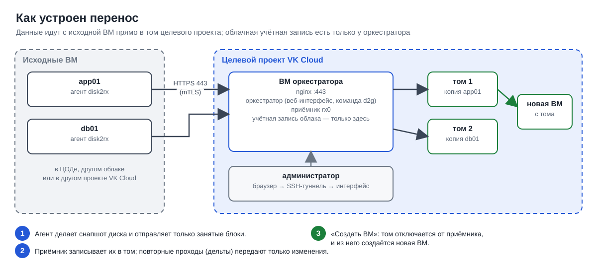

# Справочник: оркестратор d2g

Справочник по второму способу переноса — через оркестратор. Здесь собраны состав, установка,
параметры, команды `d2g`, веб-интерфейс и устройство безопасности. Если вы делаете перенос
впервые, начните с [пошагового руководства](guide.md). Термины — в
[README](../README.md#термины), оглавление документации — в [docs/README.md](README.md).

В этом способе диск исходной ВМ переносится **сразу в том Cinder** целевого проекта, без Glance
и S3. Проходы можно повторять: каждый следующий (дельта) передаёт только изменившиеся блоки.
При переключении оркестратор собирает новую ВМ из тома.

## Содержание

- [Состав](#состав)
- [Установка](#установка)
- [Перенос из командной строки](#перенос-из-командной-строки)
- [Несколько проектов](#несколько-проектов)
- [Веб-интерфейс](#веб-интерфейс)
- [Безопасность](#безопасность)
- [Пути от агента до приёмника](#пути-от-агента-до-приёмника)
- [Проверено](#проверено)
- [Планы](#планы)

## Состав

| Компонент | Где | Что делает | Какие секреты у него есть |
|---|---|---|---|
| **Оркестратор** (`d2g`, служба `d2g-orch`) | одна ВМ в целевом проекте клиента | свой CA, регистрация агентов и приёмников, тома (создать, подключить, отключить), создание приёмников, сборка ВМ из тома, расписание дельт | учётная запись облака `/etc/d2g/openrc` (600), ключ CA |
| **Приёмник rx0** (`d2g-rx`) | на ВМ оркестратора (по умолчанию) | принимает части от агентов и записывает их в подключённые тома | только свой сертификат |
| Приёмники rx1… | отдельные ВМ, их создаёт оркестратор (cloud-init) | то же, для масштабирования и других зон | только свой сертификат |
| nginx (stream) | ВМ оркестратора, порт 443 | разбирает соединения по имени в TLS (SNI) без расшифровки: `ctl.<id>.d2g` → API, `rxN.<id>.d2g` → приёмник | — |
| **Агент** `disk2rx` (служба `disk2rx-agent`) | исходная ВМ | снапшоты dattobd, отправка частей, выполнение команд оркестратора | только свой клиентский сертификат |

Учётные данные облака есть только у оркестратора. Агент может только записывать данные в свой том
через приёмник. Учётная запись облака приёмнику недоступна.



## Установка

**ВМ:** Ubuntu 24.04 (или 22.04, Debian 12) в целевом проекте. Если на ней же работает приёмник
`rx0` (по умолчанию), рекомендуется 4–8 vCPU: на 2 vCPU два параллельных переноса занимают CPU
полностью. Системный диск ceph-ssd. FIP нужен, если источники или администраторы подключаются
из интернета. Порт 22 — для администратора, 443 мастер может открыть сам. Чтобы у ВМ было по
одной очереди сетевой карты на каждый vCPU (multiqueue), до создания ВМ задайте для
загрузочного тома
`openstack volume set --image-property hw_vif_multiqueue_enabled=true <том>` (приёмники и
собираемые ВМ оркестратор создаёт так сам, см. [speed-tests.md](speed-tests.md#2-мощность-вм-источника-и-приёмника)).

**Учётная запись облака:** сервисная учётная запись проекта. Какие роли нужны — в
[service-accounts.md](service-accounts.md#учётная-запись-оркестратора).

### Одной командой, с мастером в браузере

```bash
curl -fsSL https://github.com/jaland-hara/disk2glance/releases/latest/download/d2g-server-install.sh | sudo bash
```

Скрипт загружает `d2g-server-<версия>.tar.gz` из Releases, сверяет SHA-256, устанавливает nginx
и оркестратор и запускает оркестратор в режиме первоначальной настройки. В конце скрипт выводит:

```
  d2g orchestrator ctl.5ed4d7.d2g is waiting for its setup.
  Open    https://<FIP>/setup   (grey address: https://10.0.10.8/setup)
  Code    6476-a9c1-1226    (valid 1 hour, once; a new one: sudo d2g setup-code)
  Check the certificate in the browser: SHA-256 2F:F9:33:…:60:1E
```

Параметры (после `sudo bash -s --`): `--version 0.8.2` (по умолчанию последний релиз),
`--bundle FILE` (установка из скачанного архива, без интернета), `--public-ip IP`, `--ui-allow CIDR`
(ограничить адреса, с которых открывается мастер; по умолчанию — с любых адресов, но только с кодом).

В браузере откройте адрес, сверьте отпечаток сертификата, введите код. Шаги мастера:

| Шаг | Что задаётся |
|---|---|
| 1. Администратор | имя и пароль (от 12 символов); при необходимости TOTP: QR-код для приложения, код проверяется сразу |
| 2. Облако | адрес Keystone, проект, сервисная учётная запись, домен (`service-users`), регион. «Проверить» выполняет фактические проверки: видна ли эта ВМ, создаются и удаляются том 1 ГБ и группа безопасности, видны ли FIP. Если проверка не пройдена, перейти к следующему шагу можно только явным подтверждением |
| 3. Размещение | зона, сеть, публичный адрес — подставлены из метаданных ВМ |
| 4. Приёмники | приёмник на этой ВМ (да/нет), тип томов, томов на приёмник, флейвор и ключ отдельных приёмников, FIP для них (только из свободных) |
| 5. Доступ | с каких адресов открыт интерфейс (ваш адрес подставлен), с каких адресов подключаются исходные ВМ; при необходимости — открыть 443 в группе безопасности `d2g-ctl` и подключить её к ВМ |
| 6. Применить | сводка → учётная запись в `/etc/d2g/openrc` (600), `d2g setup`, администратор, группа безопасности, `unique-boot.sh` и приёмник `rx0`, перезапуск в обычный режим |

После этого мастер закрывается (код больше не действует) и открывается вход в интерфейс. Мастер
не позволяет сохранить список доступа без вашего текущего адреса.

### Вручную, без мастера

```bash
tar xzf d2g-server-0.8.2.tar.gz && cd d2g-server-0.8.2
sudo install -d /etc/d2g && sudo install -m 600 openrc /etc/d2g/openrc   # учётная запись проекта
sudo ./install.sh --role orch --public-ip <FIP> --allow 10.0.0.0/8 --ui-allow <адрес администратора>/32
sudo d2g admin add admin
sudo d2g status
```

Если `/etc/d2g/openrc` есть, `install.sh --role orch` сразу выполняет `d2g setup` с переданными
параметрами; если нет — запускает мастер. Повторный запуск `install.sh` обновляет код и
сохраняет настройки.

### Что делает установка

- устанавливает nginx с модулем stream;
- копирует код в `/opt/d2g`, а бандлы для раздачи (агент и сервер) — в `/opt/d2g/pkg`;
- `d2g setup`: CA, сертификаты (агентский API по имени `ctl.<id>.d2g`, интерфейс по IP), группа
  безопасности `d2g-receivers`, локальный приёмник `rx0`, конфиг nginx;
- `unique-boot.sh`, потому что к этой ВМ будут подключаться тома с копиями дисков (см.
  [receiver-mode.md](receiver-mode.md#приёмник-не-должен-загружаться-с-тома-задания));
- службы `d2g-orch` и `d2g-rx`.

### Настройки после установки

Вкладка «Настройки» в интерфейсе: «Изменить доступ» (интерфейс и источники), «Изменить
приёмники» (флейвор, тип томов, томов на приёмник, пул FIP), «Учётная запись облака» (новая
учётная запись проходит те же проверки, что в мастере, и сохраняется, только если все проверки
пройдены). Изменения применяются сразу и записываются в журнал.

Те же параметры в командной строке:

| Параметр `d2g setup` | Что это |
|---|---|
| `--public-ip IP` | публичный адрес (FIP) оркестратора для агентов из интернета |
| `--allow CIDR` | кому открыт 443 на отдельных приёмниках (`d2g-receivers`) |
| `--ui-allow CIDR` | откуда открывается веб-интерфейс |
| `--fip-pool ID` | плавающие IP, которые можно назначать отдельным приёмникам |
| `--replace-lists` | `--allow`, `--ui-allow`, `--fip-pool` заменяют списки, а не дополняют |
| `--rx-flavor`, `--rx-image`, `--rx-volume-type`, `--rx-key`, `--rx-sg`, `--max-volumes` | отдельные приёмники (по умолчанию STD3-4-4, образ ВМ оркестратора, ceph-ssd, 20 томов) |
| `--no-local-receiver` | не создавать `rx0`, использовать только отдельные приёмники |
| `--ui-mtls on\|off` | требовать сертификат администратора в браузере |

## Перенос из командной строки

То же, что делает веб-интерфейс, можно выполнить командой `d2g` на ВМ оркестратора.

```bash
# 1. агент: команда с токеном, выполнить на исходной ВМ от root
sudo d2g agent add web01
#   d=$(mktemp -d) && curl -fsSk --resolve ctl.5ed4d7.d2g:443:<IP> https://ctl.5ed4d7.d2g/v1/ca.pem -o $d/ca.pem \
#     && echo '<SHA-256 CA>  '$d/ca.pem | sha256sum -c --quiet \
#     && curl -fsS --cacert $d/ca.pem --resolve ctl.5ed4d7.d2g:443:<IP> https://ctl.5ed4d7.d2g/install.sh | sudo sh -s -- <IP> <токен> web01

# 2. задание: по тому на каждый диск ВМ -> подключение к приёмнику -> первый проход запускается автоматически
sudo d2g job new web01 [--every 3600]      # --every: дельта раз в час
sudo d2g job new web01 --disks vda,vdb     # не все диски (загрузочный обязателен)
sudo d2g job list
sudo d2g job show <job>                    # тома задания и состояние каждого

# 3. дельты по команде или по расписанию
sudo d2g job sync <job>
sudo d2g job sync <job> --every 1800

# 4. переключение: остановить приложение на источнике (при необходимости), последняя дельта, сборка ВМ
sudo d2g job sync <job>
sudo d2g job finish <job> --flavor STD3-4-8 --network <сеть> --sg default --key <ключ> [--name web01]

# 5. удалить агент с источника
sudo d2g agent uninstall web01
```

`job finish` ожидает, пока приёмник освободит тома, отключает их, делает том загрузочного диска
загрузочным, задаёт ему свойства образа (из `props.json` источника или из `/etc/os-release`) и
создаёт ВМ в той же зоне: загрузка с этого тома, остальные тома подключаются в порядке дисков
исходной ВМ. Флейвор проверяется до отключения томов; если создать ВМ не удалось (например, не
хватило квоты), `job finish` можно повторить. `job delete` освобождает и удаляет все тома
задания.

Если у приёмника в нужной зоне нет свободного места под тома (по умолчанию 20 томов на приёмник),
`job new` создаёт новый приёмник автоматически. Его можно создать и заранее:

```bash
sudo d2g receiver add [--az PA2] [--flavor STD3-8-8] [--fip <id>|auto]
sudo d2g receiver list
sudo d2g receiver delete rx1
```

Сколько дисков рекомендуется на один приёмник: до 20 подключённых и до 6 одновременных первых
проходов на приёмник с 8 vCPU (см. [speed-tests.md](speed-tests.md#сколько-дисков-на-один-приёмник)).

**Зоны доступности: свой приёмник на каждую зону.** Том задания, приёмник, к которому он
подключён, и будущая ВМ всегда находятся в одной зоне. Зону выбирают при создании задания
(`job new --az`, в интерфейсе — поле «Зона»), по умолчанию это зона оркестратора. Подключать том
к приёмнику из другой зоны оркестратор не пытается: в VK Cloud такая возможность то
появляется, то пропадает. Поэтому рекомендуем отдельный приёмник на каждую зону, куда
переносятся ВМ, даже в одном проекте. Оркестратор делает это сам: если в зоне задания нет
приёмника со свободным местом, он создаёт его в этой зоне. Приёмник `rx0` на ВМ оркестратора
принимает только задания в зоне оркестратора. Создать приёмник заранее:
`sudo d2g receiver add --az <зона>`; указать приёмник из другой зоны в `job new --receiver`
нельзя.

Новый приёмник создаётся примерно за 1,5 минуты: том из образа, ВМ, загрузка бандла с
оркестратора через cloud-init, `unique-boot.sh`, регистрация, первый отчёт.

## Несколько проектов

Один оркестратор переносит ВМ не только в свой проект («этот проект», `home`), но и в другие
проекты облака: для каждого добавляется служебная учётная запись этого проекта. Учётные записи
хранятся только на ВМ оркестратора (`/etc/d2g/targets/<имя>.openrc`, права 600) и при добавлении
проходят те же проверки, что в мастере (том 1 ГБ и группа безопасности создаются и удаляются).

| Способ | Как работает | Что нужно в проекте | Когда |
|---|---|---|---|
| **Передача тома** (`transfer`) | диск принимается в проекте оркестратора (`rx0` или его приёмники); при «Создать ВМ» том отключается, передаётся в проект (Cinder volume transfer: запрос — учётной записью оркестратора, приём — учётной записью проекта), и ВМ создаётся там | только служебная учётная запись | проекты того же региона; ни приёмников, ни FIP в проекте |
| **Свой приёмник** (`receiver`) | оркестратор учётной записью проекта создаёт в нём приёмник (cloud-init) и группу безопасности `d2g-receivers`; тома создаются и принимаются в этом проекте, там же из них собираются ВМ | учётная запись и сеть; FIP для приёмника, если источники подключаются через интернет | другой регион; данные не должны появляться в проекте оркестратора; источник расположен рядом с проектом (та же сеть или Direct Connect) |

В режиме «свой приёмник» приёмник подключается к оркестратору по его **публичному адресу** (FIP
оркестратора обязателен); оркестратор сам открывает 443 от адреса роутера сети приёмника в своей
группе `d2g-ctl` (если она подключена к его ВМ). Агенты подключаются к такому приёмнику по серому
адресу (источник в той же сети или за Direct Connect этого проекта) или по FIP приёмника; путь
через оркестратор тоже доступен только при наличии у приёмника FIP.

Добавить проект — вкладка «Проекты» → «Добавить проект»: учётная запись → «Проверить учётную
запись» → настройки из списков этого проекта (зона, сеть, группы безопасности новых ВМ; для своего
приёмника — флейвор, тип томов, ключ, FIP, с каких адресов подключаются источники) → «Сохранить». В «Новом задании» выбирается «Куда
переносить», форма «Создать ВМ» показывает флейворы, сети, группы безопасности и ключи того проекта.

То же в командной строке:

```bash
sudo d2g target add kz --title "VK Cloud KZ" --mode receiver --openrc /tmp/kz.openrc \
  --az QAZ --network dmz-kz --rx-flavor Standard-4-8 --allow 10.0.0.0/24 --vm-sg default --vm-sg ssh
sudo d2g target add client-a --mode transfer --openrc /tmp/client-a.openrc --network client-net
sudo d2g target list | check NAME | set NAME [...] | delete NAME
sudo d2g job new web01 --target kz
```

## Веб-интерфейс

Интерфейс работает в той же службе оркестратора и открывается по его адресу:
`https://<FIP оркестратора>/`. Агенты и приёмники подключаются к тому же порту 443 по имени
`ctl.<id>.d2g`, а браузер обращается по IP и получает интерфейс с отдельным сертификатом.

Вкладки:

| Вкладка | Что на ней |
|---|---|
| Обзор | сколько ВМ подключено, сколько заданий, что синхронизировано, приёмники; текущие проходы с прогрессом; последние операции |
| Исходные ВМ | «Добавить ВМ» → готовая команда установки (кнопка «Скопировать»); ОС, ядро, диск, модуль, путь до приёмника, адрес, последний отчёт; «Проход», «Новый токен», «Удалить агента», «Отключить» |
| Задания | «Новое задание» (ВМ, её диски, тип тома, зона, расписание дельт); прогресс; «Дельта», «Расписание», «Создать ВМ» (флейвор, сеть, группы безопасности, ключ — списки из облака), «Удалить» |
| Приёмники | состояние, адреса, тома, нагрузка; «Добавить приёмник», «Удалить» |
| Журнал | операции интерфейса с журналом выполнения в реальном времени; журнал событий (кто и что сделал: `admin` — командная строка, `ui:<имя>` — интерфейс, агенты, приёмники) |
| Настройки | текущие параметры оркестратора; доступ, приёмники и учётная запись облака меняются кнопками на этой вкладке или командой `d2g setup` |

Изменения из интерфейса выполняются той же командой `d2g` от root (только проверенные значения,
без shell), поэтому интерфейс и командная строка ведут себя одинаково. Долгие операции (тома, ВМ,
приёмники) выполняются в фоне, их журнал выполнения виден на вкладке «Журнал».

### Администраторы

Первого администратора создаёт мастер. Остальные — на ВМ оркестратора:

```bash
sudo d2g admin add anna             # пароль от 12 символов
sudo d2g admin totp anna            # второй фактор: секрет и ссылка otpauth:// для приложения
sudo d2g admin passwd anna | delete anna | list
sudo d2g admin cert anna            # сертификат для браузера (.p12), затем d2g setup --ui-mtls on
```

Если интерфейс открыт по FIP, порт 443 в группе безопасности ВМ оркестратора должен быть открыт
и для адресов администраторов (мастер открывает его сам, если отмечен соответствующий пункт).

## Безопасность

### Сертификаты и шифрование

1. `d2g setup` создаёт CA (EC P-256) и сертификат оркестратора на имя `ctl.<id>.d2g`.
2. `d2g agent add NAME` выдаёт одноразовый токен (1 час) и команду установки, в которой есть
   SHA-256 сертификата CA оркестратора. Команда скачивает сертификат CA, принимает его, только
   если совпал SHA-256 (`sha256sum -c`), и дальше обращается к оркестратору только по TLS с
   проверкой по этому CA: скрипт установки, бандл агента, регистрация. Так команда работает с
   любым curl, в том числе 7.29 из CentOS 7 (там нет `--pinnedpubkey` и `--connect-to`).
3. Ключ агента (EC P-256; RSA 2048, если curl собран с NSS, как в CentOS 7: там curl не
   работает с клиентским ключом EC) создаётся на исходной ВМ и её не покидает. Оркестратор подписывает запрос на
   сертификат с именем агента. Вместе с запросом агент передаёт описание системы: ОС, ядро, диск,
   есть ли модуль dattobd, свойства образа.
4. Приёмник получает сертификат так же, по одноразовому токену из cloud-init (у `rx0` его сразу
   выпускает оркестратор). В сертификате приёмника его имя `rxN.<id>.d2g`.
5. Все соединения — TLS с проверкой сертификатов обеими сторонами. Приёмник допускает агента только к
   тому заданию, где совпадают имя и серийный номер сертификата агента. `d2g agent revoke` закрывает
   доступ на всех приёмниках в течение 5 с.
6. Агент подключается к нужному адресу с именем сервера (`curl --resolve`), поэтому серый
   канал, FIP и передача через оркестратор проверяются одинаково, и DNS не нужен.

### Копия не может выдать себя за исходную ВМ

Новая ВМ — копия диска источника, поэтому в ней есть сертификат агента и служба `disk2rx-agent`.
Без защиты копия опрашивала бы оркестратор под именем источника и могла бы выполнить его команду.
Поэтому:

- служебный юнит, который на копии при первой загрузке удаляет COW-файлы dattobd, запускается
  раньше агента и удаляет его идентичность (`d2g.env`, ключ, сертификат) и автозапуск;
- при регистрации агент запоминает UUID ВМ (`/sys/class/dmi/id/product_uuid`, в OpenStack это ID
  инстанса). Если при запуске UUID другой, агент удаляет идентичность и выключается.

### Веб-интерфейс без домена

| Мера | Как |
|---|---|
| Свой сертификат интерфейса | одиночный самоподписанный сертификат (не CA) на IP оркестратора. `d2g setup` выводит его отпечаток SHA-256: при первом входе его сверяют с отпечатком в браузере или импортируют сертификат в систему. CA агентов в браузер не устанавливается: им можно было бы подписать сертификат любого сайта |
| Доступ по подсетям | интерфейс открывается только с адресов из `--ui-allow` (реальный адрес клиента передаёт nginx по PROXY protocol); с остальных — ответ 403. По умолчанию список пуст, интерфейс закрыт |
| Пароль | хеш scrypt; 5 неверных попыток → пользователь и адрес блокируются на 5 минут |
| Второй фактор | TOTP (Google Authenticator и т. п.), `d2g admin totp ИМЯ` |
| Сертификат администратора (необязательно) | `d2g admin cert ИМЯ` выпускает `.p12` для браузера, `d2g setup --ui-mtls on` делает его обязательным: без него интерфейс не откроется |
| Сессия | cookie `Secure`, `HttpOnly`, `SameSite=Strict`; выход после 30 мин бездействия, не дольше 12 ч |
| Запросы | каждое изменение — с CSRF-токеном в заголовке; строгая CSP без inline-скриптов и стилей, запрет встраивания во фреймы, `no-referrer`, `no-store` |
| Журнал | входы, неудачные попытки и все действия записываются в журнал событий |

Ограничение: пока сертификат не импортирован, браузер показывает предупреждение. Если отпечаток
не сверить и просто принять сертификат, при атаке «человек посередине» (MITM) на первом входе
пароль может быть перехвачен. TOTP и сертификат администратора делают такой пароль бесполезным.

Доступ через SSH-туннель также поддерживается и не требует открывать 443 для адреса администратора:

```bash
d2g setup --ui-allow 127.0.0.1/32
ssh -L 8443:127.0.0.1:443 ubuntu@<оркестратор>      # затем https://localhost:8443/
```

## Пути от агента до приёмника

Как передавать данные только по частной сети (Direct Connect, VPN), без интернета, — в
[network.md](network.md).

Оркестратор передаёт агенту адреса приёмника по порядку, агент использует первый ответивший:


| Путь | Когда |
|---|---|
| `rx-grey`: серый IP приёмника | источник в ЦОДе за Direct Connect или в той же сети |
| `rx-fip`: FIP приёмника | у отдельного приёмника есть свой FIP из пула (`d2g setup --fip-pool`) |
| `ctl`: публичный адрес оркестратора, дальше SNI | источник подключается через интернет, отдельного FIP у приёмника нет; для `rx0` это основной путь |
| `ctl-grey`: серый адрес оркестратора, дальше SNI | источник в ЦОДе, но прямого доступа к приёмнику нет |

Путь можно закрепить за агентом: `d2g agent add NAME --path ctl`.

nginx передаёт приёмникам и API реальный адрес источника (PROXY protocol), поэтому в
`d2g agent list` виден адрес, с которого подключился агент.

## Проверено

Протоколы испытаний оркестратора, мастера, переноса между регионами и в другой проект —
в [test-reports.md](test-reports.md). Скорость переноса — в [speed-tests.md](speed-tests.md).

## Планы

- Вход через SSO (OIDC), роли администраторов (только просмотр / управление).
- Контейнеры оркестратора и приёмника для распространения.
- Тестовый запуск ВМ со снапшота тома без остановки синхронизации.
- Отслеживание изменённых блоков (CBT), чтобы дельта не читала весь диск.
- Проверка режима «передача тома» на втором проекте того же региона.
