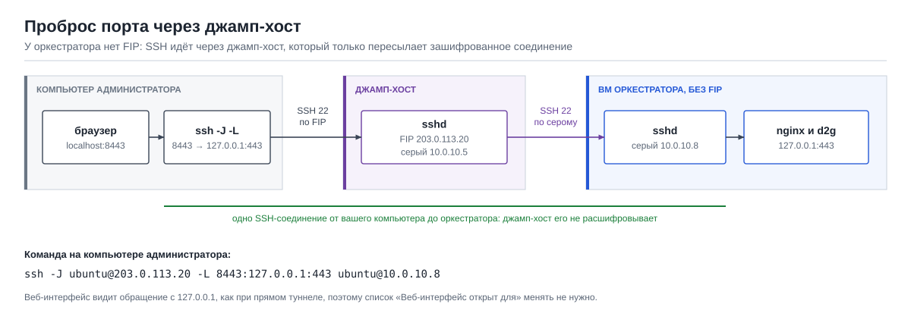

# Подключение по SSH и проброс портов

Справка о том, как подключиться к ВМ (узлу) по SSH и открыть веб-интерфейс оркестратора через
туннель, в том числе когда у ВМ нет внешнего адреса и подключаться приходится через джамп-хост.
Пошаговый запуск продукта — в [guide.md](guide.md), сетевые сценарии — в
[network.md](network.md). Адреса в примерах условные: `203.0.113.x` — внешние (FIP),
`10.0.10.x` — серые адреса сети проекта.

## Содержание

- [Подключение напрямую](#подключение-напрямую)
- [Подключение через джамп-хост](#подключение-через-джамп-хост)
- [Короткие имена в ~/.ssh/config](#короткие-имена-в-sshconfig)
- [Проброс порта веб-интерфейса](#проброс-порта-веб-интерфейса)
- [Копирование файлов](#копирование-файлов)
- [Windows](#windows)
- [Как подготовить джамп-хост в VK Cloud](#как-подготовить-джамп-хост-в-vk-cloud)
- [Если не подключается](#если-не-подключается)

## Подключение напрямую

Если у ВМ есть внешний адрес (FIP) и группа безопасности пропускает порт 22 с вашего адреса:

```bash
chmod 600 ~/.ssh/<ключ>            # только macOS и Linux: ключ должен быть доступен только вам
ssh -i ~/.ssh/<ключ> ubuntu@203.0.113.10
```

Пользователь в образах Ubuntu VK Cloud — `ubuntu`, в других образах бывает `centos`, `debian`,
`almalinux` или `root`. При первом подключении SSH показывает отпечаток ключа сервера и
спрашивает, доверять ли ему: ответьте `yes`.

## Подключение через джамп-хост

**Джамп-хост** (бастион) — небольшая ВМ с внешним адресом, через которую подключаются к ВМ
без внешнего адреса. Он нужен, например, когда:

- у оркестратора нет FIP (режим без публичных адресов, см. [network.md](network.md));
- исходные ВМ в ЦОДе доступны только через бастион;
- нужно зайти на ВМ проекта, созданную без FIP (новая ВМ после переноса, приёмник).

Команда — параметр `-J` (ProxyJump):

```bash
ssh -J ubuntu@203.0.113.20 ubuntu@10.0.10.8
```

Здесь `203.0.113.20` — FIP джамп-хоста, `10.0.10.8` — серый адрес нужной ВМ. SSH сначала
подключается к джамп-хосту, а через него — к нужной ВМ. Шифрованное соединение идёт от вашего
компьютера до нужной ВМ: джамп-хост только пересылает его, закрытый ключ на джамп-хост
копировать не нужно.

**Ключи.** Параметр `-i` в командной строке относится только к последней ВМ, джамп-хосту он не
передаётся. Если ключ лежит не в стандартном месте (`~/.ssh/id_ed25519`, `~/.ssh/id_rsa`),
сделайте одно из двух:

- добавьте ключ в агент SSH — тогда его увидят оба подключения:

  ```bash
  ssh-add ~/.ssh/<ключ>
  ssh -J ubuntu@203.0.113.20 ubuntu@10.0.10.8
  ```

- или укажите ключи в `~/.ssh/config` (следующий раздел).

**Несколько джамп-хостов** перечисляются через запятую, по порядку: `-J user@jump1,user@jump2`.

**Старый OpenSSH.** Параметр `-J` есть в OpenSSH 7.3 и новее. В более старых версиях то же
самое делает `ProxyCommand`:

```bash
ssh -o ProxyCommand="ssh -W %h:%p ubuntu@203.0.113.20" ubuntu@10.0.10.8
```

## Короткие имена в ~/.ssh/config

Чтобы не набирать адреса и ключи каждый раз, опишите узлы в файле `~/.ssh/config` на своём
компьютере:

```
Host d2g-jump
    HostName 203.0.113.20
    User ubuntu
    IdentityFile ~/.ssh/<ключ>

Host d2g-ctl
    HostName 10.0.10.8
    User ubuntu
    IdentityFile ~/.ssh/<ключ>
    ProxyJump d2g-jump
    LocalForward 8443 127.0.0.1:443
```

После этого:

- `ssh d2g-ctl` — подключение к оркестратору через джамп-хост, сразу с туннелем к
  веб-интерфейсу (строка `LocalForward`);
- `ssh d2g-jump` — подключение к самому джамп-хосту.

Для исходных ВМ за бастионом в ЦОДе — так же: свой блок `Host` с `ProxyJump` на бастион ЦОДа.

## Проброс порта веб-интерфейса

Веб-интерфейс оркестратора слушает порт 443. Наружу его открывать не нужно: порт пробрасывают
на свой компьютер через SSH (параметр `-L`), а в браузере открывают `https://localhost:8443/`.

**Оркестратор с FIP** — как в [шаге 4 руководства](guide.md#шаг-4-открыть-веб-интерфейс-через-ssh-туннель):

```bash
ssh -i ~/.ssh/<ключ> -L 8443:127.0.0.1:443 ubuntu@203.0.113.10
```

**Оркестратор без FIP, через джамп-хост:**



```bash
ssh -J ubuntu@203.0.113.20 -L 8443:127.0.0.1:443 ubuntu@10.0.10.8
```

Или, с файлом `~/.ssh/config` из предыдущего раздела, просто `ssh d2g-ctl`.

Что означает `-L 8443:127.0.0.1:443`: соединения на порт 8443 вашего компьютера передаются по
SSH на оркестратор и там — на `127.0.0.1:443`, то есть в nginx оркестратора. Поэтому
веб-интерфейс видит обращение с `127.0.0.1`, и список «Веб-интерфейс открыт для» менять не
нужно.

> **Не пробрасывайте порт на самом джамп-хосте**, то есть не используйте
> `ssh -L 8443:10.0.10.8:443 ubuntu@203.0.113.20`. В этом случае к оркестратору подключается
> джамп-хост со своего серого адреса: веб-интерфейс ответит `403 forbidden`, пока этот адрес
> не добавлен в «Веб-интерфейс открыт для», а группа безопасности оркестратора должна
> пропускать порт 443 с джамп-хоста. С `-J` ничего этого не нужно.

**Полезные варианты:**

| Задача | Команда |
|---|---|
| Туннель без командной строки на ВМ | добавьте `-N`: `ssh -N -J ubuntu@203.0.113.20 -L 8443:127.0.0.1:443 ubuntu@10.0.10.8` |
| Туннель в фоне | добавьте `-f -N`; закрыть — `pkill -f 8443:127.0.0.1:443` (macOS, Linux) |
| Порт 8443 занят | возьмите другой: `-L 9443:127.0.0.1:443` и откройте `https://localhost:9443/` |
| Мастер настройки | тот же туннель, адрес `https://localhost:8443/setup` |

## Копирование файлов

`scp` и `sftp` понимают тот же параметр `-J` и имена из `~/.ssh/config`:

```bash
scp -J ubuntu@203.0.113.20 ./file.txt ubuntu@10.0.10.8:/tmp/
scp ./file.txt d2g-ctl:/tmp/
```

## Windows

В Windows 10 (версия 1809 и новее) и Windows 11 клиент OpenSSH встроен: команды `ssh`, `scp`
и параметр `-J` работают в PowerShell так же, как выше. Файл настроек —
`C:\Users\<имя>\.ssh\config`, ключи — в той же папке, путь к ключу пишется как
`~/.ssh/<ключ>` или полностью.

Агент SSH в Windows по умолчанию выключен. Включить (PowerShell от имени администратора):

```powershell
Get-Service ssh-agent | Set-Service -StartupType Automatic
Start-Service ssh-agent
```

Затем в обычном окне PowerShell: `ssh-add $HOME\.ssh\<ключ>`.

Если ключ проще указать в `~/.ssh/config`, агент не нужен.

## Как подготовить джамп-хост в VK Cloud

1. Создайте небольшую ВМ (1 vCPU, 1 ГБ памяти, Ubuntu 24.04) в той же сети, что и
   оркестратор, и назначьте ей FIP.
2. Группа безопасности джамп-хоста: входящий TCP 22 **только с адресов администраторов**.
3. Группа безопасности оркестратора (и других ВМ без FIP): входящий TCP 22 с серого адреса
   джамп-хоста или из его группы безопасности.
4. Открытый ключ администратора добавьте и на джамп-хост, и на ВМ за ним (при создании ВМ —
   поле «Ключ»).

Чего не делать:

- не храните закрытые ключи на джамп-хосте: с `-J` они там не нужны;
- не используйте `ssh -A` (пересылку агента), чтобы попасть на ВМ за джамп-хостом: `-J`
  решает ту же задачу без доступа джамп-хоста к вашему агенту.

## Если не подключается

| Что видно | Что сделать |
|---|---|
| `Permission denied (publickey)` до джамп-хоста | джамп-хосту не передан ключ: `-i` действует только на последнюю ВМ. Добавьте ключ в агент (`ssh-add`) или в `~/.ssh/config` |
| `Permission denied (publickey)` до нужной ВМ | неверный ключ или пользователь (`ubuntu`, `centos`, `root`…) |
| `Connection timed out` до джамп-хоста | группа безопасности не пропускает порт 22 с вашего адреса или у ВМ нет FIP |
| `Connection timed out` или `channel 0: open failed` после джамп-хоста | группа безопасности нужной ВМ не пропускает порт 22 с джамп-хоста. Проверка с джамп-хоста: `nc -vz 10.0.10.8 22` |
| `bind [127.0.0.1]:8443: Address already in use` | туннель уже открыт в другом окне или порт занят: закройте старый туннель или возьмите другой порт |
| `REMOTE HOST IDENTIFICATION HAS CHANGED` | ВМ пересоздана на том же адресе. Если вы это знаете точно: `ssh-keygen -R 10.0.10.8`, затем подключитесь снова. Если ВМ не пересоздавали — не подключайтесь и выясните причину |
| Браузер: `403 forbidden` | туннель проброшен с джамп-хоста, а не с оркестратора: используйте `-J`, как в разделе «Проброс порта веб-интерфейса» |
| Браузер не открывает `https://localhost:8443` | окно с туннелем закрыто или в нём ошибка; проверьте, что команда запущена с `-L` |
